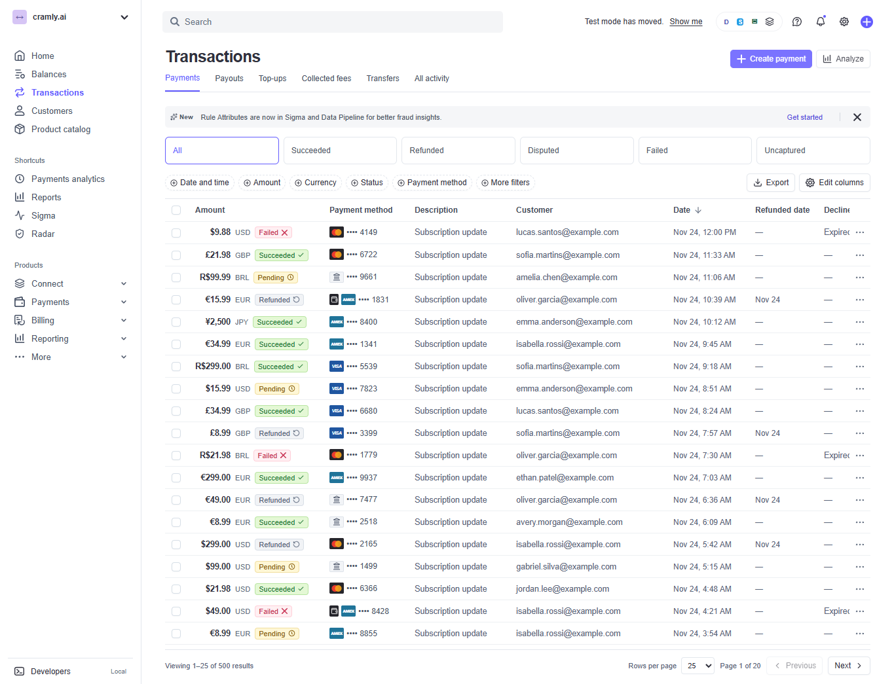

# Stripe payments screen

A Stripe-inspired payments dashboard built for the Chargeblast front-end assessment
with Next.js, strict TypeScript, React, CSS Modules and accessible Radix primitives.
The application uses 500 seeded synthetic payments; no Stripe account or backend is required.



## Run locally

Use Node.js 22.18 or newer (validated with Node.js 24) and npm.

```sh
npm ci
npm run dev
```

Open http://localhost:3000/payments. Servers bind to loopback by default.
For a production preview, run `npm run build` followed by `npm start`.
No environment variables or external fonts are required.

## Features

- Required payment fields, currency-aware amounts, four status badges, full-ID copy
  with error recovery, and hover/focus relative-time tooltips in Brasilia time.
- Search by payment ID, email or last four digits; combine calendar date ranges,
  multi-select statuses/methods, amount bounds and currency filters.
- Row and page selection with a mixed checkbox state, inline status badges, refund/decline
  columns, and accessible row-action menus.
- Six reference summary views, including disputed and uncaptured synthetic payments.
- Stable date/amount/status sorting and 25/50/100-row pagination, including empty
  states, page resets and disabled boundary navigation.
- Responsive sidebar/top bar and a mobile drawer with focus trapping and restoration.
- Payment details with timeline, metadata, direct navigation and unknown-ID handling.
- Shareable filter/sort/page state, including refresh and browser back/forward.
- Column resizing and drag reordering, with keyboard, slider and button alternatives.
- CSV export of all filtered/sorted rows across pages in the selected column order.

## Verify

```sh
npm run check
npm run test:e2e
```

`check` runs ESLint, strict types, seeded-data checks, query/state/URL/CSV checks and
an optimized production build. Playwright builds the app and starts its own local
production server on port 3200. Keep that port free; installed Google Chrome is required.
The browser suite includes functional journeys, automated accessibility scans and
reviewed screenshots. Open the local report with `npx playwright show-report`.

Screenshots use Windows/Chrome baselines at fixed viewport sizes and a fixed clock.
To deliberately regenerate baselines after a reviewed visual change:

```sh
npm run test:e2e -- --update-snapshots
```

Inspect changed images before accepting them, then run the suite again without
updates. Other operating systems/browser versions can render fonts differently.
Reports, downloads and failure traces are ignored by Git and are never uploaded.

## Architecture

- `src/app/payments/`: server-rendered list and dynamic details route.
- `src/features/payments/data.ts`: one server-side dataset/timestamp boundary.
- `types.ts`, `mock-data.ts`: discriminated methods, integer minor-unit amounts and
  deterministic, realistic synthetic data with reserved example.com email addresses.
- `query.ts`, `state.ts`, `url-state.ts`: pure filtering, sorting, pagination,
  state transitions and validated URL serialization.
- `columns.ts`, `csv.ts`: column constraints and escaped CSV serialization.
- `src/features/payments/components/`: focused table, filter, pagination and column controls.
- `src/components/`: dashboard shell and shared Radix-based UI components.
- `scripts/`, `tests/`: data/query verification, browser journeys and visual baselines.

A native semantic table and a small typed reducer cover this dataset without a
large table/state dependency. Radix provides keyboard/focus behavior for layered
controls; extracted Stripe SVGs cover matching dashboard icons and Lucide supplies the rest. CSS controls visual fidelity.

## Decisions and limits

- Written requirements take priority over conflicting reference details: four
  required statuses, full payment IDs and 25/50/100 page sizes. The creation timestamp
  uses the reference label Date. Customer absorbs extra desktop width while other
  columns retain their widths; narrow screens scroll the table horizontally.
- Cross-currency amount sorting/filtering compares numeric major units without FX
  conversion. A currency filter lets reviewers compare one currency at a time.
- Calendar presets include today in America/Sao_Paulo; custom endpoints are inclusive.
  Relative tooltips refresh on opening. CSV timestamps use explicitly labeled UTC.
- Each view keeps one dataset anchor; shareable URLs carry it so reload/details
  preserve dates. `PAYMENTS_MOCK_ANCHOR` can fix the server clock for local QA.
- URL values are validated and unknown values ignored. Column layouts are in-memory
  and reset on reload; filter/sort/pagination state is shareable.
- CSV includes full IDs and follows the displayed column order. All values are
  quoted, quotes/newlines are escaped and formula-like text is neutralized.
- Unrelated navigation, payment creation and analytics actions are outside the demo.
- Original font and undocumented Stripe interactions could not be verified against
  a live dashboard. Exact pixel equality and full WCAG compliance are not claimed.
- Automated checks run in Chrome; Firefox/Safari and a manual screen-reader audit
  have not been completed. Clipboard failure/success branches use controlled tests.

ESLint 9 is pinned because the current Next.js preset's React/import/accessibility
plugins declare compatibility through that major. npm marks it unsupported upstream;
upgrade once all preset plugins support ESLint 10.

## Review materials

- [Requirements checklist](docs/requirements.md)
- [Reference analysis](docs/reference-analysis.md)
- [Implementation decisions](docs/implementation-decisions.md)
- [Functional and visual QA](docs/qa-report.md)
- [Delivery checklist and submission draft](docs/delivery-checklist.md)

The project is prepared locally. Hosting, repository publication/access verification
and submission remain separate steps. Original assessment screenshots and real
customer data are not included in the committed visual baselines.
